
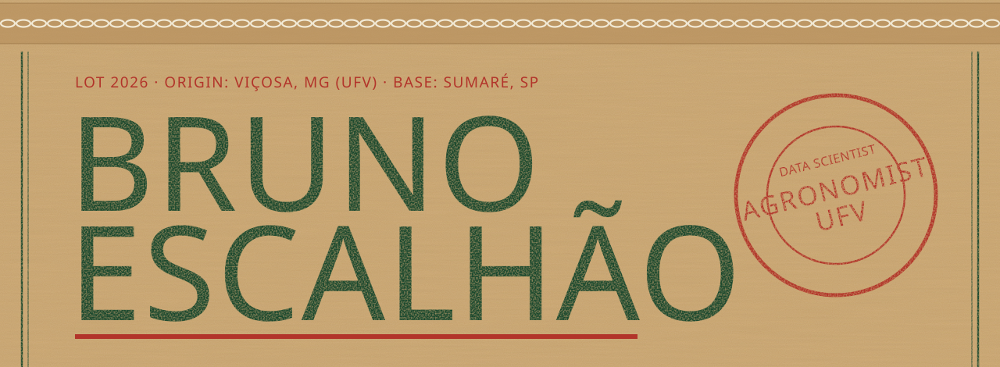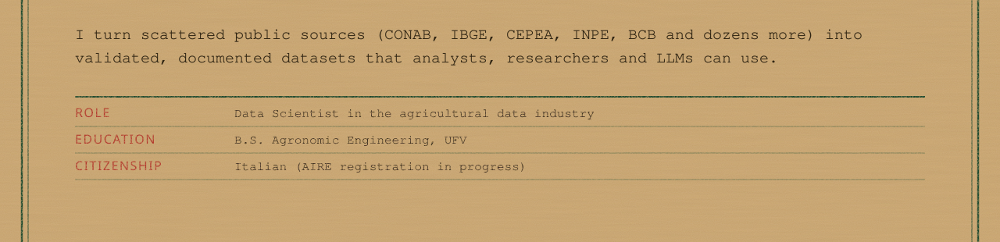<a href="https://github.com/bruno-portfolio/agrobr">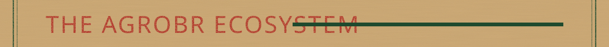</a><a href="https://github.com/bruno-portfolio/agrobr">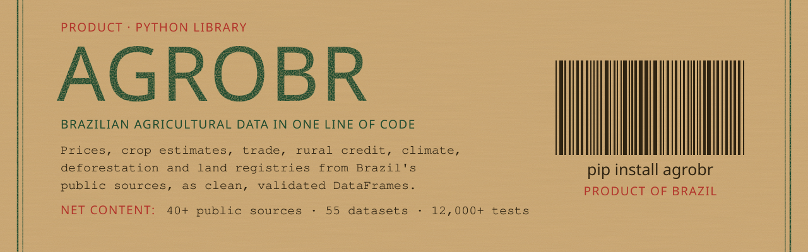</a><a href="https://github.com/bruno-portfolio/agrobr-mcp">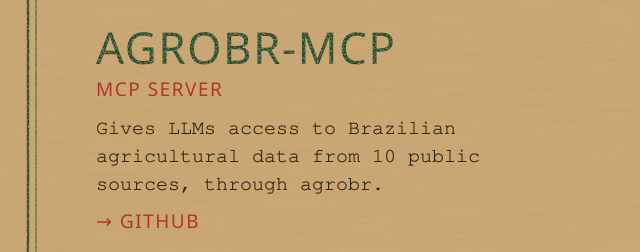</a><a href="https://github.com/bruno-portfolio/agrobr-qgis">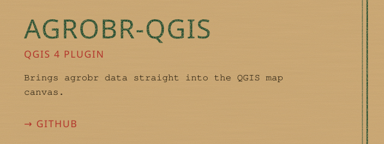</a><a href="https://github.com/bruno-portfolio/mapbiomas-crop-validation">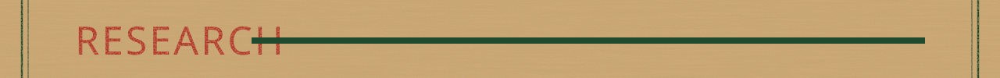</a><a href="https://github.com/bruno-portfolio/mapbiomas-crop-validation">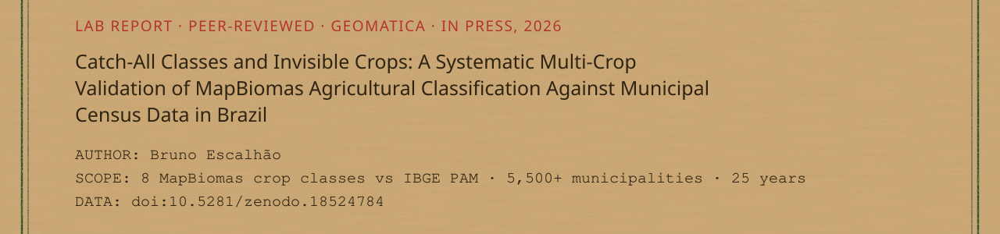</a>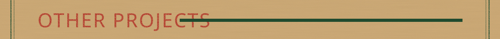<a href="https://github.com/bruno-portfolio/hypokrates">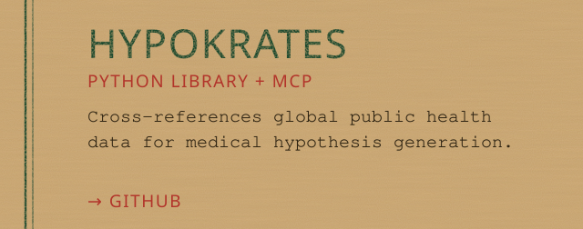</a><a href="https://github.com/bruno-portfolio/BasisMind">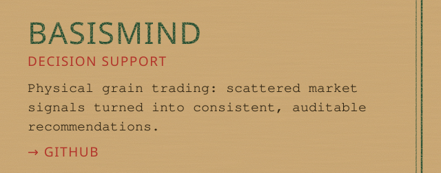</a><a href="https://github.com/bruno-portfolio/brazil-soybean-forecast">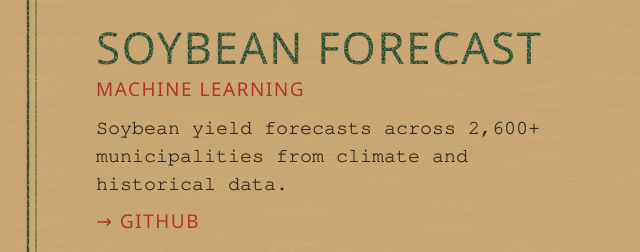</a><a href="https://github.com/bruno-portfolio/Flor-de-Lei">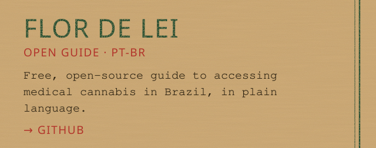</a>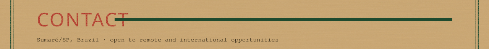<a href="https://www.linkedin.com/in/brunoescalhao">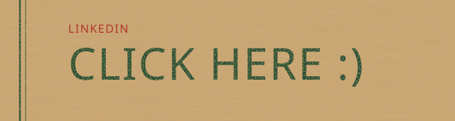</a><a href="mailto:brunoescalhao@gmail.com">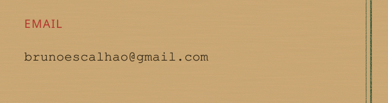</a>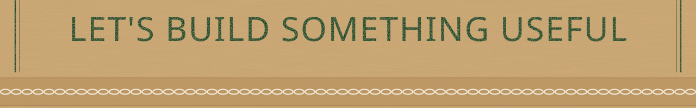

